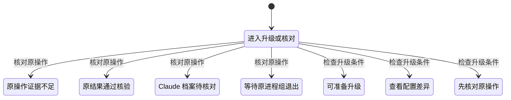

# Agent CLI 升级与核对

| 终端结果 | 发生了什么 | 下一步 |
| --- | --- | --- |
| 已有维护操作待核对 | 先检查上一次的结果。同一次升级已经完成时，直接显示结果。上一次操作结束且与这次无关时，重新准备本次升级。 | 一般只需重跑原命令。需要查看待检查的操作时，运行 `mo recover`。 |
| 本机 mise 配置与管理源不同 | 本次请求在准备阶段退出。提示列出两份文件和目标工具的版本。 | 运行 `mo config reconcile` 查看差异。明确只更新本机时，按提示先用 `--local --dry-run` 查看范围。 |
| 原进程组仍存在 | 原进程还需要核对，恢复暂未继续。 | 等相关进程退出，再按原操作编号核对。 |
| 原结果通过核验 | 目标载荷、实际版本和原操作的配置关系通过检查。原安装和源记录依据同一操作完成核对。 | 用 `mo agent tools` 查看当前版本与固定版本。 |
| 原操作仍待核对 | 输出显示具体原因，例如目标载荷证据不足、配置与原计划不同，或 Claude 升级期间档案发生改动。 | 核对当前版本、配置或显示的文件。确认保留当前状态且需要人工结束原操作时，运行 `mo recover ID --mark-failed` 并阅读确认。该动作只记录失败和解除该记录造成的阻断。 |

Claude CLI 升级核对原 Claude 档案快照。其它工具的核对使用自己的冻结条件。早期记录带有多余的 Claude 快照时，程序仍校验整份原计划的摘要，并按记录中的目标工具决定证据范围。所有写入沿用原操作的锁、目标和原生证据校验。工件或配置证据不足时保留原操作供核对。

## 状态检查



旧模型的两个反例分别对应升级先报配置差异，以及 Codex 核对被 Claude 档案改动阻断。新模型的 64 个状态通过 5 条不变量及死锁检查。图省略终态停留。配置证据和载荷证明抽象为核对条件，实际目录身份、并发校验、载荷探测和安装器调用次数由隔离的原生夹具验证。

将三个 [AgentRecovery 模型文件](models/ai_upgrade/) 复制到独立临时目录。将 `TLA2TOOLS` 设为 TLC JAR 的绝对路径，将 `STATECHART` 设为 statechart 技能目录下 `scripts/statechart` 的绝对路径。在临时目录运行以下命令。将 CFG 中的 `Legacy` 改为 `TRUE` 可重放旧反例。

```sh
"$STATECHART" AgentRecovery.tla --config AgentRecovery.cfg \
  --view AgentRecovery.view.mjs --out agent-recovery
```
