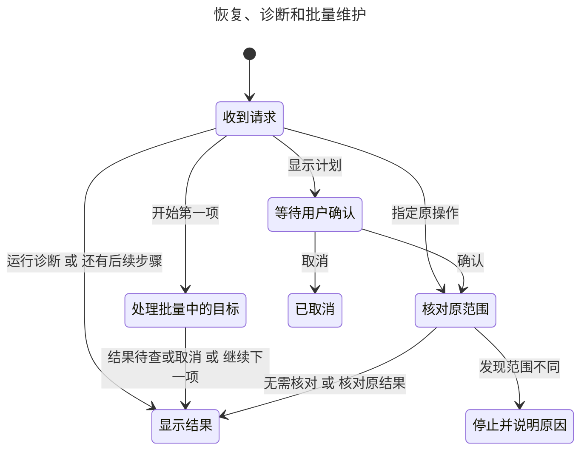

# 命令受理、恢复与结果复查

上一轮合并了已有配置的插件安装流程。安装确认、原结果核对、目标登记和批量停止都有同一个入口。此次继续检查了应用维护、Agent 启动与归档、推荐、chezmoi 诊断、技能与治理回退、终端界面和 JSON 退出状态。

| 问题 | 根因 | 处理 |
| --- | --- | --- |
| 指定操作号恢复时，原记录可能从另一套 settings 或 cache 下收口 | 自动恢复、历史界面和命令行各自解释恢复范围 | `operations` 统一核对 HOME、状态、缓存和 settings。写锁内再次检查。指定原操作仍使用记录冻结的进程环境 |
| 取消启动、插件首装或历史配置恢复时，旧操作可能已被核对。单独配置归档也可能需要另跑恢复 | 根命令和交互界面先恢复，实际命令稍后才确认；归档走另一条入口 | 新建配置安装、启动、偏好设置、归档和历史恢复在已确认的入口核对旧状态。随后重新核验原计划 |
| 新建插件配置的重试可能用了不同的启停，或重跑已完成的 Codex 市场登记 | 重试匹配的证据没有覆盖启停选择和市场阶段 | 在核对前匹配原提交、配置类型及启停。Codex 从已核验的市场步骤继续。手动核对也会给出固定原来源的继续命令 |
| 软件批量升级遇到执行错误或拒绝 Brew 授权后仍继续 | 批量协调只识别成功返回中的未知结果 | 执行错误与未知结果都结束本批，结构化结果带未执行列表。Brew 前置取消直接退出 |
| 遇到待核对记录时无法运行部分配置诊断 | 配置查询和写入共用待处理写入检查 | 诊断继续持有原生调用租约和写审计，在上一次运行完成后校验迁移状态。登记、刷新快照和应用配置继续校验待处理写入 |
| 安装阶段、治理回退和 Brew 缺失的文本与退出码不一致 | 调用方分别把原生状态当成整个命令结果 | 全屏和普通终端共用继续状态，未确认的整次操作返回退出码 3。治理回退同时返回原 `status` 与规范 `phase`。Brew 保留 JSON 字段，缺失和已安装按对应语义呈现 |

## 状态模型

模型假定原生调用的租约可取得。该图用有限状态检查本次迁移的带确认恢复、指定目录的手动恢复、待处理时的诊断、批量停止和阶段成功。图省略终态停留及无状态变化的分支。目录和原生程序身份、锁、目录变更及写后证据通过隔离测试检验。

TLC 在新模型中检查了 64 个状态和 5 条不变量。旧模型分别复现确认前恢复、错范围恢复、待处理阻断诊断、批量中止后继续、阶段显示整次成功。模型文件见 [CommandBoundaries](models/operation/CommandBoundaries.tla)。将三个同名模型文件复制到临时目录，用已有 [状态图验证命令](operation-flows.md#状态检查) 运行。把配置中的 `Legacy` 改为 `TRUE` 可重现旧流程。

## 验证

在隔离源码和构建目录通过格式、严格 Clippy、单独文档测试、990 项单元测试和 352 项集成测试。全量采集的区域覆盖率为 84.9436%。在同一生产源码上补测并发续装、冻结证据丢失、启停变化、原生命令拒绝和 Brew 取消后，区域覆盖率为 85.0092%，通过项目门槛。独立复审通过。

## 确认与查询边界

推荐技能和原生技能菜单由执行适配器确认目标后核对旧状态。应用选择器的打开与取消是只读的。直达维护中，命令调用本身已授权执行的动作可自动核对旧记录。重复同一操作沿用原授权。需要先核对才能准备新计划的入口会单独说明旧操作，确认绑定到这条记录及其摘要。Brew 原生计划仍按核验后的实际范围确认。

chezmoi、Brew 和 Native Skills 的受管原生查询共用一个执行器。启动前通过 macOS 的 `pgrep` 检查能否观察进程组。工具在 Brew 沙盒中也适用。主程序退出时，执行器先保留组长，验证进程组是否还有运行成员。一份时限覆盖主程序、辅助进程和进程组观察。超时请求终止本次创建的组，并保留组长及查询锁直到确认组内进程停止。若操作系统无法终止进程或无法提供组证据，清理等待可能超过时限。结果仍记为未确认。命令范围内的查询审计保留，事务执行器仍负责持有写入租约。已脱离所建进程组的任务不属于这项查询保证。[QueryLifetime 状态模型](models/operation/QueryLifetime.tla) 检查了 11 个状态。旧模型复现了过早回收组长和超时后等待；合成测试另外核对了观察器受限和原进程组消失的路径。

## 跨轮复盘

| 用户看到的问题 | 根因 | 采用的修复 |
| --- | --- | --- |
| 推荐模型设置被 Codex 升级记录阻断，钥匙串条目名称也像随机字符串 | 设置向导借用了软件维护入口和全局阻断。凭据存储把服务上下文编码进了条目名称 | 推荐凭据和软件维护各自管理状态与锁。推荐 API 密钥使用一个稳定条目，配置记录保存服务绑定和版本 |
| Codex 升级遇到 mise 差异，旧操作却报 Claude 配置变化 | 升级先检查新计划，然后才处理旧结果。不同工具共用过宽的配置证据 | 自动核对先检查旧结果。冻结记录按原始工具、目录和配置范围核验。Codex 和 Claude 各自检查适用的证据 |
| 插件装进陌生目录，或单选、多选的确认和重试行为不同 | 把原生安装的隔离配置当成了用户目标。单选、多选和新建配置各自编排安装 | 选择并冻结实际配置目录。已有配置共用确认、登记与逐个安装。隔离目录里的产物核对后才写入用户选中的配置 |
| 取消仍可能修改记录，批量失败仍可能继续，输出把阶段成功说成全部完成 | 入口仅凭“写命令”标签先恢复。批量和界面各自读取适配器 JSON，将多个不同结果误当成同一状态 | 区分已有授权的原操作、本次计划的确认和实际写入。批量在第一个未完成结果处停止。统一阶段、终态、缺失和失败的提示与退出码 |
| 设置了查询超时，主程序退出后却还在等 | 捕获层只给主程序计时，适配层在组长回收后另起一个无时限的等待 | 把进程组所有权和剩余时间放进同一执行器。还持有原组长时观察或终止，只接受已核对的退出 |

这些问题反复出现，主要因为原来的接口只描述了单个函数的输入和返回值。业务语义跨越了确认、原生执行、写后核对和恢复几层，缺少一个负责整段流程的模块。业务出现第二个入口时，共用的是零散函数，顺序和结果解释又在新入口重写了一遍。

部分原有检查验证了命令是否得到回执，覆盖不了回执后仍有下一阶段、尚未执行的批量成员、确认期间证据变化，以及主进程退出后仍活着的辅助进程。这几轮补的是这些跨边界的实际结果。状态图用来发现遗漏的分支，隔离 CLI 测试核对退出码、原记录、目录身份和真实原生命令的调用次数。

## 完成验证

对同一份最终生产源码运行所有 Cargo 目标，共 998 项单元测试和 357 项集成测试。首轮有三项用例仍断言旧的确认和超时语义。迁移后定向复跑通过，保留了原记录、收据、安装器调用次数与辅助进程结果的断言。格式、严格 Clippy、独立文档测试、18 项工具测试和独立复审均通过。区域覆盖率为 85.0051%。编译后的 CLI 在隔离 HOME 中完成了实际执行验证。
