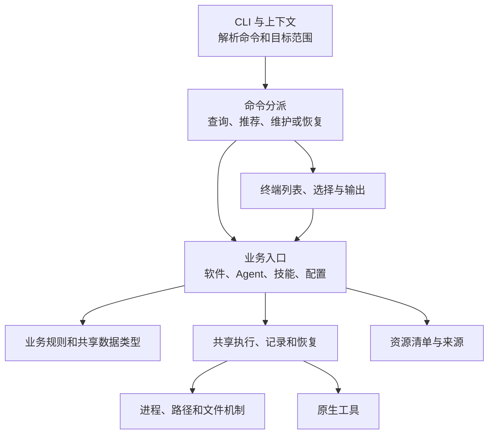

# 架构与模块

项目使用一个 Rust workspace 成员 `crates/app`。发行一个二进制，通过 `mo` 或 `macops` 启动。按所属业务划分模块，共享规则与平台机制分开维护。先从业务入口读起，就能找到它依赖的共享能力。 [Cargo workspace](../../Cargo.toml)

图展示日常命令的主要调用。恢复分派会回到原业务适配器核对证据。只读查询也可以使用共享原生执行机制。 [恢复实现](../../crates/app/src/operations/recovery.rs)

## 从入口定位代码

下表路径都在 `crates/app/src` 下。

| 问题 | 先读这里 | 负责的边界 |
| --- | --- | --- |
| 参数怎么解析，命令去哪 | [`cli.rs`](../../crates/app/src/cli.rs) · [`lib.rs`](../../crates/app/src/lib.rs) · [`context.rs`](../../crates/app/src/context.rs) | 命令语法、路径与范围、受理与分派 |
| 表头、选择和结果在哪里 | [`browser.rs`](../../crates/app/src/browser.rs) · [`terminal/`](../../crates/app/src/terminal/) · [`output.rs`](../../crates/app/src/output.rs) | 资源浏览、交互确认和输出映射。文本表格及多选共用终端呈现组件 |
| 推荐依据如何变成候选 | [`recommend/`](../../crates/app/src/recommend/) | 检索、验证和展示来源。模型只参与建议 |
| CLI、配置和插件装到哪里 | [`agent/`](../../crates/app/src/agent/) | Agent CLI、配置登记、原生插件适配、目标发布与续装 |
| 多个 Agent 怎么操作 | [`skills/portfolio.rs`](../../crates/app/src/skills/portfolio.rs) · [`skills/`](../../crates/app/src/skills/) | 能力的目标选择、共享写入、批量结果，及 Skills CLI 的安装和维护 |
| 文件归属和来源维护在哪里 | [`capability/`](../../crates/app/src/capability/) · [`source/`](../../crates/app/src/source/) | 能力归属和共享字段，核对固定 Git 数据，从来源账本构建、同步和发布载荷 |
| 软件和配置如何修改 | [`software/`](../../crates/app/src/software/) · [`config/`](../../crates/app/src/config/) | 各软件渠道、服务和 chezmoi 的原生契约 |
| 清单、选择器和索引怎么来 | [`catalog/`](../../crates/app/src/catalog/) | 汇总实例、解析选择器、版本索引和缓存 |
| 状态有哪些，校验在哪 | [`domain/`](../../crates/app/src/domain/) · [`policy/`](../../crates/app/src/policy/) | 共享数据类型和规则。业务专属规则放在对应目录下的 `rules/` |
| 怎样写记录、启动和恢复 | [`operations/`](../../crates/app/src/operations/) · [`migration/`](../../crates/app/src/migration/) | 写锁、操作记录、命令环境、恢复分派，及独立的旧数据迁移 |
| 文件和进程的机制在哪 | [`platform/`](../../crates/app/src/platform/) | 进程捕获与时限、路径、目录句柄与文件身份 |

## 调用如何进入业务

`lib.rs` 的 `run` 先识别内部执行入口，再检查命令作用域。推荐设置使用独立上下文，迁移命令处理自身的事务。其余命令通过迁移状态检查后，进入交互浏览或普通分派。浏览器里发起的写入在确认时仍要检查变化。涉及恢复时，以原操作的作用域和已经明确的授权为依据。 [命令受理模型](../models/README.md#命令受理与操作核对)

需要读取文件、进程或网络时，适配器提供事实，规则根据事实给出判断。比如 `platform::fs` 读取目录身份，插件适配器决定这份身份是否仍和用户确认的目标一致。`operations::command` 用作用域构造程序与参数，`platform::process` 执行给定命令。进程层无需知道插件或软件的业务状态。目录中的显式命令配方需要按本机可执行配置审查。

## 扩展与性能

新增软件渠道时，先确定原生身份、可观察范围和受支持的写操作，再接入清单、适配器与恢复。新增 Agent 客户端时，先定义配置绑定、原生载荷与启用证据，再接入已有目标选择与维护流程。新增终端入口应复用同一个业务入口，由入口拥有确认、执行及结果解释。跨模块可见性以真实调用点为依据。

| 机制 | 能减少的工作 | 评审时核对 |
| --- | --- | --- |
| 版本索引 | `outdated` 复用已查数据。显式 `refresh` 承担刷新成本 | 是否把旧索引当作当前证据，是否在画面重绘或循环中重复刷新 |
| 内容寻址缓存 | 内容相同的索引可以复用 | 缓存归属和有效性是否单独核对，清理是否误删共享对象 |
| 批量目标归并 | 相同共享技能或实际插件目标可以只调用一次 | 去重键是否绑定实际对象和请求动作，结果是否正确回填 |
| 本机观察与有界读取 | 文件型观察可绕开不需要的进程启动。uv 超预算会返回未知 | 新路径的目录数、读取字节、外部调用次数和最坏情况 |
| 原生输出实时呈现 | 用户可以看到等待期间的进度 | 终端重绘、日志截断、重定向和 JSON 是否仍有各自的行为 |

性能比较应使用相同输入和环境，区分冷缓存与热缓存，记录总时长、外部调用次数和实际瓶颈。涉及共享文件、目录或进程的改进还要复核并发、恢复和取消路径。 [代码审查](../development/review.md)
