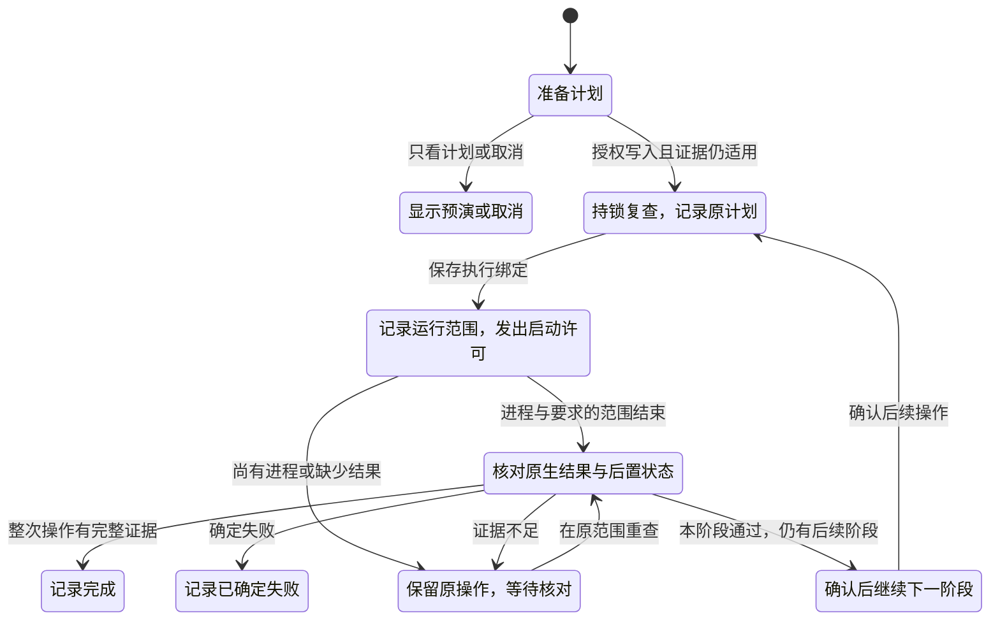

# 操作执行与恢复

大多数维护要经历准备、原生执行和结果核对。安装器输出完成只说明一个阶段结束。macops 还要确认达到目标，保存回执才报告完成。

图描述普通写入及多阶段插件安装的主要路径。实现中的日志类型、原生阶段和具体可恢复状态因适配器而异。 [操作实现](../../crates/app/src/operations/mod.rs) · [原生执行器](../../crates/app/src/operations/native_runner.rs) · [操作模型](../models/operation/Operation.tla)

## 代码怎样保留恢复证据

1. 计划包含原目标、动作、版本和适用作用域。确认后取得需要的锁，重新核对迁移、未完成操作和计划证据。
2. 写入 `Prepared` 及冻结输入。原生执行记录 `Running`、worker 和执行范围后发出启动许可。部分原生执行器在外部进程运行期间持有原 HOME 锁。
3. 检查原进程及要求的进程组范围，再观察后置状态。只有完整证据才能写成功回执。结果不明保留记录，后续核对使用相同计划、作用域和写入证据。
4. 业务适配器区分失败、待核对和仍需继续的阶段。核对可补齐原操作回执。需要新的原生阶段时，按提示单独确认。

原生查询的时限覆盖主进程和所建进程组的观察。执行器在回收组长前检查同组是否仍有成员。请求终止后仍须等到停止证据。操作系统无法提供证据时，等待可超过配置时限，结果保留未确认。主动脱离所建进程组的任务超出这项保证。 [进程执行器](../../crates/app/src/platform/process.rs) · [查询生命周期模型](../models/operation/QueryLifetime.tla)

## 用户如何继续

| 结果 | 下一步 |
| --- | --- |
| 查看或取消 | 回到清单。再次操作前查看计划 |
| 已完成同一请求 | 查看原结果。重复执行在适用入口可直接返回它 |
| 上次已收口，目标不同 | 重新准备本次操作，核对新计划 |
| 原进程仍在运行 | 等待原操作结束，再用同一范围重试 |
| 结果待核对 | 重跑支持自动核对的原命令，或用 `mo recover` 找记录。使用 `mo recover ID --dry-run` 查看原计划 |
| 原阶段已核验，需要续装 | 按提示运行 `mo agent resume ID --dry-run`，再确认续装 |
| 已人工核对，决定保留现状 | 支持时用 `mo recover ID --mark-failed` 确认记录为失败。该动作不能还原原生改动 |

自动核对发生在需要写入且适用的命令路径。交互中的确认仍须绑定原操作或当前计划。浏览、取消和预演可用于获取信息。迁移中的普通命令受独立迁移检查约束。核对持有原范围所需的锁，沿用原操作的记录和适配器。出现范围变化或证据损坏时，读历史与提示定位问题。

`mo history ID`、`mo recover` 或结构化输出可查操作编号。交互历史的详情可按界面提示确认核对。继续阶段与整次操作完成有不同的输出，需关注时返回退出码 3。

[恢复实现](../../crates/app/src/operations/recovery.rs) · [命令受理与自动核对模型](../models/README.md#命令受理与操作核对)
