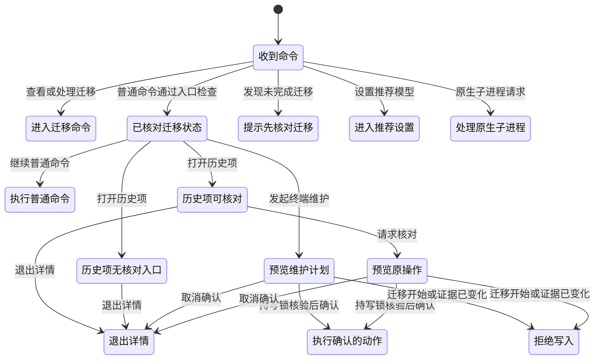

# 状态模型

状态模型约束实现中的提交顺序、原始证据和恢复条件。TLA+ 文件与 CFG 是可执行规范。目录中的适用模型及各自验证器一并保留。

| 范围 | 检查 |
| --- | --- |
| 软件操作、共享执行器和服务 | 原命令启动、进程存续、目标作用域、写锁、终态与恢复 |
| 缓存和目录策略 | 不可变索引、自有清理与共享边界 |
| 配置、能力事务、档案同步、原生 Skills 和插件 | 文件版本竞争、归属投影、部分完成及原操作验证 |
| 源交付和 AI CLI | 冻结候选、外部载荷、版本及账本写入边界 |
| Brew 和 chezmoi | 原生查询、缺失证据、单次写入、恢复与未知状态 |
| 数据转换 | 旧写入口停写，原位保留、提交前回滚与发布后收口 |
| uv 观察 | 零原生命令、冻结根身份和旧记录兼容 |

运行 `python3 -B tools/verify_models.py` 可检查该脚本登记的 TLA+ 基线和可达状态。Brew、chezmoi、源交付和能力等专题的验证器位于 `tools/`，其中 `verify_uv_model.py` 检查 uv 的模型和错误逻辑。`verify_native_plugin_model.py` 直接以 Python 检查 Codex 插件的受理、执行与恢复，需要 Python 3.10 或更新版本。实际文件系统、进程和 CLI 行为由编译产物验收。 [验证](../verification.md)

## 统一管理入口

[control_plane](control_plane/) 收录管理入口的有界安全模型。安装受理检查授权、前态和原生证据。npm 绑定区分原收据、新收据和未知结果。配置源动作检查原文件身份、单文件发布、目录同步及缓存恢复。模型解释只附着原公开证据。清单重放检查正式配方、原作用域、明确版本及未决操作。

先将 `TLA2TOOLS_JAR` 设为 TLC JAR 的绝对路径，再将对应的 TLA 与 CFG 复制到独立临时目录，从该目录运行 `java -cp "$TLA2TOOLS_JAR" tlc2.TLC -dfid 24 -workers 1 -config NAME.cfg NAME.tla`。chezmoi 分别使用 `ChezmoiSource-add.cfg` 和 `ChezmoiSource-forget.cfg`。

## 命令受理与操作核对

[CommandAdmission](control_plane/CommandAdmission.tla) 检查输出模式是否影响普通命令的迁移拦截、专用入口是否仍可到达，以及终端维护和核对能否在确认前拒绝新增的迁移标记。操作记录按原阶段待核对、后续阶段待登记或继续、证据不完整及已完成分类。模型将目录、锁和适配器证据抽象为离散条件。实际的文件身份、子进程、Claude 后继记录筛选和收据发布由编译产物测试覆盖。



旧入口模型在 169 个状态中产生两个反例。最短的一步路径是收到命令后，迁移未完成时仍进入普通命令。两步路径是收到命令、通过受理，再打开已完成原生阶段的 Claude 历史项，页面缺少核对入口。修正后的 138 个状态通过 5 条不变量及无死锁检查。图省略原始证据和迁移标记变化时停留在原页面的步骤，以及完成后的停留步骤。模型范围限定为单次调用和一个终端预览。

将三个 `CommandAdmission.*` 文件复制到独立临时目录。配置 `TLA2TOOLS` 为 TLC JAR 的绝对路径，`STATECHART` 为 statechart 技能目录下 `scripts/statechart` 的绝对路径。从临时目录重新生成图。将 CFG 中的两个 `Legacy` 常量改为 `TRUE` 可重放旧反例。

```sh
"$STATECHART" CommandAdmission.tla --config CommandAdmission.cfg \
  --view CommandAdmission.view.mjs --out command-admission
```
