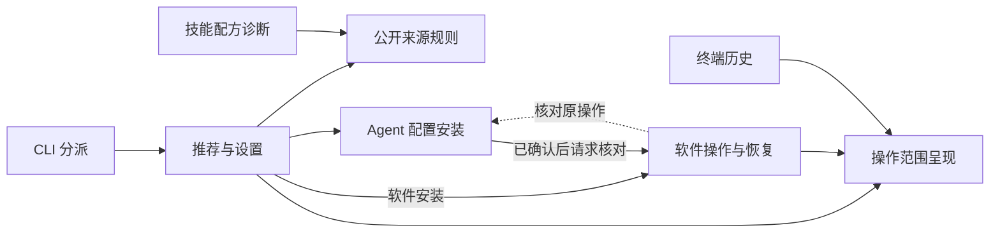

# macops 模块重构方案

基线为 `f683c21`。`crates/app/src` 有 150 个 Rust 文件，95 个在根目录。保留现有 Cargo crate，以推荐原型验证组织方式，再迁移其他业务、共享契约和平台原语。单批按模块归属验收，最后对完整的发布候选跑全量检查。

## 目标结构

| 模块 | 职责 | 边界 |
| --- | --- | --- |
| `recommend/` | 来源核对、候选分析、模型设置与凭据、推荐页面 | 构造和展示建议。用户选择实际安装后交给对应业务入口 |
| `agent/` | Agent 工具升级、配置登记与生命周期、客户端插件安装 | 客户端适配器负责原生调用。目标发布负责目录身份、写入及重试证据 |
| `skills/` | 技能配方、技能安装与维护、来源和收据 | Skills CLI 配方与 Agent 原生插件各有执行入口 |
| `software/` | 软件实例、发现、安装升级、卸载、服务和原生适配器 | 由管理器适配器解释版本、实例身份和原生结果 |
| `config/` | 配置观察、本机配置事务、chezmoi 来源与投影 | 配置模块负责目标身份、变更和恢复证据 |
| `capability/`、`source/` | 能力归属、共享字段、文件发布原语及固定来源的证据与同步 | 能力账本与来源账本各自拥有记录。受管路径、快照和 CAS 保持原来的写入约束 |
| `catalog/` | 组装资源清单、解析选择器、管理版本索引和缓存 | 跨业务聚合由此提供。各业务保留原生发现逻辑 |
| `migration/` | 核对旧数据与写入方，发布迁移账本 | 互斥、复查及回退证据与迁移状态同属一个模块 |
| `domain/`、`operations/` | 共享的 `Plan`、`Journal`、收据与命令执行、恢复分派 | `domain` 定义共享数据契约。恢复分派调用各业务适配器核对原操作 |
| `platform/process`、`platform/fs` | 原生进程等待、捕获、时限、目录身份和文件操作等技术原语 | 只有可独立表达的操作进入平台层。由应用层把 `Scope`、原调用和事务证据转成原语输入 |

CLI 和终端从业务模块的入口调用完整能力。共享类型和纯规则只依赖更基础的数据。命令编排可请求核对，恢复分派在锁内依次核对迁移、命名空间、冻结输入和对象或进程，再调用业务核对入口。核对入口沿用已锁定的 `Store` 和原 `Journal`，禁止重复争抢总锁或重新进入 `recover_before_write*`。现有 `output`、`browser`、`terminal` 分别提供文本、浏览数据与交互支持。

## 第一批迁移

七份推荐源码归到一个目录，采用现有 `brew.rs` 与 `brew/` 的分组思路。推荐根模块包含业务入口和现有候选交互，以下子模块保持私有。

| 当前路径（相对 `crates/app/src`） | 目标路径 |
| --- | --- |
| `recommend.rs` | `recommend/mod.rs` |
| `recommend_upstream.rs` | `recommend/upstream.rs` |
| `recommend_model.rs` | `recommend/model.rs` |
| `recommend_setup.rs` | `recommend/setup.rs` |
| `recommend_keychain.rs` | `recommend/keychain.rs` |
| `policy/recommend.rs` | `recommend/candidate.rs` |
| `policy/recommend_model.rs` | `recommend/model_policy.rs` |

推荐对外提供 `run`、`run_setup` 和 `interactive`。`lib` 保留命令受理、上下文构造及输出封装。普通推荐把已解析的参数交给 `run`，由它选择来源、生成报告并按原条件进入交互。设置仍在软件维护恢复检查之前进入 `run_setup`，接收 `RecommendSetupContext`。

下面的箭头表示第一批迁移后的调用方向。图仅列出本次相关的入口。

两处已共享的功能随迁移归位。

- `policy/public_source.rs` 保存推荐与技能诊断共用的 GitHub 仓库名解析，以及来源链接格式校验。保留现有输入和错误语义。`capability::rules::delivery::github_repository` 的输入契约另有约束，沿用原入口。
- `terminal/plan.rs` 保存操作范围和来源标签的呈现。推荐、`operations` 和终端都从这里取文案。本模块直接使用 `output::sanitize`，沿用 URL 查询参数与片段的裁剪及 mise 范围解析。

`profile_install` 继续负责已有配置的确认回调、目录复查、恢复、登记和批量停止。Codex、Claude Code 适配器继续核验原生安装，`plugin_target` 拥有目标写入与发布记录。`operations` 按原记录分派到客户端核对入口。推荐设置独立持有配置和钥匙串记录。第一批迁移保留这些调用及其顺序。

## 整体迁移批次

1. **Agent。** 先归组 `resource_agents`、`profile_install`、`plugin_target`、`ai_*` 和 Codex、Claude Code 安装适配器。推荐页选择候选，Agent 负责选择兼容配置、确认、启停、登记、安装和续做。使用固定来源的插件值描述 Codex 或 Claude Code 候选，应用和技能候选仍由各自的安装入口处理。`mo skill plugins` 从技能命令分派并调用 Agent 的客户端适配器，插件首装和维护共用安装事实。验收装到选定配置、取消零写、结果待查时不重跑安装器、批量停止、不同客户端的升级范围，以及可续做阶段的核对。
2. **技能、软件、配置。** 三项分别提交、分别验收。先归组 `native_skills*`、`brew`、`chezmoi_*`，再移动对应的清单读取入口。分别核对技能的固定来源与收据、软件管理器的目标实例与退出状态、配置的目标目录与写入恢复。`native_skills_files` 中的 `regular`、`private`、`write_cas_checked` 也服务于推荐模型设置。移动技能前先确认这些方法的共享归属，保留错误码、文件大小上限、锁和校验顺序。
3. **清单、能力与来源。** 将跨业务资源清单、目标解析、索引和缓存归入 `catalog/`，将 `capability_*` 和 `source_*` 归入各自的目录。把推荐设置借用的受约束文件操作放回共享的能力文件层，文件句柄、路径和目录身份保留在平台层。保持技能、配置、来源和 Agent 的错误码、策略、文件大小限制、锁内复查及写入顺序。
4. **事务和技术原语。** 将 `Plan`、`Journal`、`Receipt` 与资源数据留在 `domain/`，将写入、回执、恢复分派和 `native_runner` 归入 `operations/`。操作的范围和环境构造在 `operations/command.rs`，接收已构造命令的捕获、进程组观察、时限和终止在 `platform/process.rs`，终端进度转发归入 `terminal/`。路径和持句柄校验进入 `platform/fs.rs`。业务命令可请求核对，核对适配器复用执行与记录接口。用现有测试逐项核对已确认操作、冻结环境、进程组时限、文件身份及写后证据。

业务和基础设施模块迁入具名目录。crate 根目录放命令、上下文、界面等入口。各调用方直接引用责任模块，拆出的纯规则保留原质量等级。遇到必须改变确认、写入顺序、恢复语义或持久化协议的情况，单独设计并审查该变更。以批次为边界回退源码，原记录可继续由回退版本读取。

## 验收范围

| 约定 | 验证 |
| --- | --- |
| Cargo crate、依赖、公开 CLI 契约 | 检查清单、锁文件和调用边界。对基线与原型的已构建 CLI 比较退出码、stdout、stderr 和合成目录副作用 |
| 来源、候选、手动安装说明、设置入口 | 保留原测试及断言。通过 CLI 验证仓库预演、显式来源、模型设置、无效账户和技能配方诊断 |
| 安装、取消、恢复与持久化 | 保留合成测试的目标身份、原生调用次数、回执、取消零写和恢复分支断言。复查已有待核对操作、维护状态不可读或迁移待处理时，`--setup` 仍可读取自身配置。以原测试为重放入口。[CLI 测试](../crates/app/tests/cli.rs) · [推荐模块测试](../crates/app/tests/unit/recommend_catalog.rs) |
| 模块可见性与质量门槛 | 内部模块用私有声明和受限可见性。同步更新 `#[path]`，将插件安装和恢复测试随其职责迁移。比较基线与候选的测试清单，已有用例只允许模块前缀变化。`candidate.rs`、`model_policy.rs` 和 `public_source.rs` 均在 `required_pure` 中，行、函数和区域须达 100%。`terminal/plan.rs` 归入 `io_files` |
| 专项验证脚本 | 更新硬编码的源码路径、替换目标和单元测试全名。验证编译产物运行原行为，至少重放公共写入保护的变异测试，确认原断言仍能发现错误实现 |

原型使用从基线提取的独立源码和构建目录。Cargo 检查包括格式、严格 Clippy、所有 target 测试和单独的文档测试。既有状态模型覆盖推荐、目标安装和恢复；本批没有新增状态转换，验证重点为路径、可见性及原有运行行为。后续阶段若改变跨模块状态合同，应在设计评审前更新相应模型，检查确认、失败、取消和恢复路径，再用编译后的入口重放。

## 验证记录

第一批方案已通过独立设计与测试设计评审。原型以 `f683c21` 为基线，在 Apple Silicon macOS 上验证。根目录 Rust 文件由 95 个减至 90 个，Cargo 清单和锁文件字节一致。原型验证的结果如下。

| 检查 | 结果 |
| --- | --- |
| 格式、严格 Clippy、所有 Cargo 目标、独立文档测试 | 通过。1,007 项单元测试、358 项集成测试，文档测试目标没有用例。对比 `cargo test --workspace --all-targets --all-features --locked --offline -- --list`，仅预期的单元测试模块前缀变化 |
| 已构建 CLI 的结果对照 | 15 个场景的退出码、stdout 和 stderr 逐字节一致，合成目录无增量写入。覆盖 GitHub 主题和显式来源、文件证据、模型预演、配方诊断以及维护与迁移待处理时的设置入口 |
| 状态模型 | TLC 复跑 [RecommendJourney](models/control_plane/RecommendJourney.tla)、[ModelAssist](models/control_plane/ModelAssist.tla) 和 [AgentInstallTarget](models/agent_install/AgentInstallTarget.tla)，分别检查了 56、197 和 434 个不同状态，配置中的不变量均通过 |
| 工具与覆盖率 | 18 项工具测试通过。行 92.9176%，函数 92.4705%，区域 85.0446%。所有纯策略模块达到 100%，沿用原质量门槛 |
| 独立原型复核 | 通过。核对共享函数及调用边界、141 个测试和夹具文件、覆盖率分类，并独立复跑两份 CLI 的 GitHub 仓库预演 |

首次构建被本机 `sccache` 的沙盒权限拒绝，清空 `RUSTC_WRAPPER` 后通过。原型首次 Clippy 找到一处旧模块路径，更新后通过。TLC 默认启动的 RMI 监听被沙盒拒绝，使用仓库的 `LoopbackOnlyTlc.java` 在仅回环环境重跑通过。

原型 CLI SHA-256 为 `f7b0fb9e89c4f17e11224ae9d8e9f4a12f5ff26e00716197fe32478f754345f2`。本轮行为验证使用合成数据和隔离目录。第一批已经验证通过，后续批次基于同一 Git 基线实现。

整体方案通过独立前置评审。评审将 Agent 确认、原操作范围、冻结环境、进程组终止、句柄目录替换和打包版本列为实际验证锚点。相关实现用现有 Agent、操作、进程及目录测试核对。

首轮整体检查发现多选子进程仍按旧测试名查找用例，覆盖率负控与部分变异脚本也沿用了旧路径。修正测试选择、验证位置和纯策略依赖检查，并补测已核验插件实际进入推荐列表的顺序。门禁、缓存身份及冻结 HOME 的三个原有变异均被回归测试识别。

第二轮通过项目门槛，函数覆盖率为 92.4581%，低于同条件基线的 92.4705%。检查未覆盖函数后，在原终端子进程用例中补验启用、停用和取消，以及从实际安装入口取消时无状态写入。保留原有多选输入及提示断言。

## 集成与发布

完整候选单独通过 [开发验证](verification.md) 的 `tools/check.sh` 和独立复核，同条件对照基线覆盖率，并记录通过检查的 Git 树。提交使用正常钩子，以快进方式集成至 `main`。候选包含从最近的公开版本之后已进入本地 `main` 的命令调整。公开版本采用 `v0.4.0`，因为新版命令入口与 `v0.3.0` 存在兼容性差异。

确认 `origin/main` 和新标签指向已验提交后，由仓库的标签工作流构建并发布 Apple Silicon 包。发布完成后核对工作流、标签、二进制版本和 SHA-256。清理过期分支前确认分支已经合入主干、没有关联的活动工作树或待处理请求，并验证删除结果。
