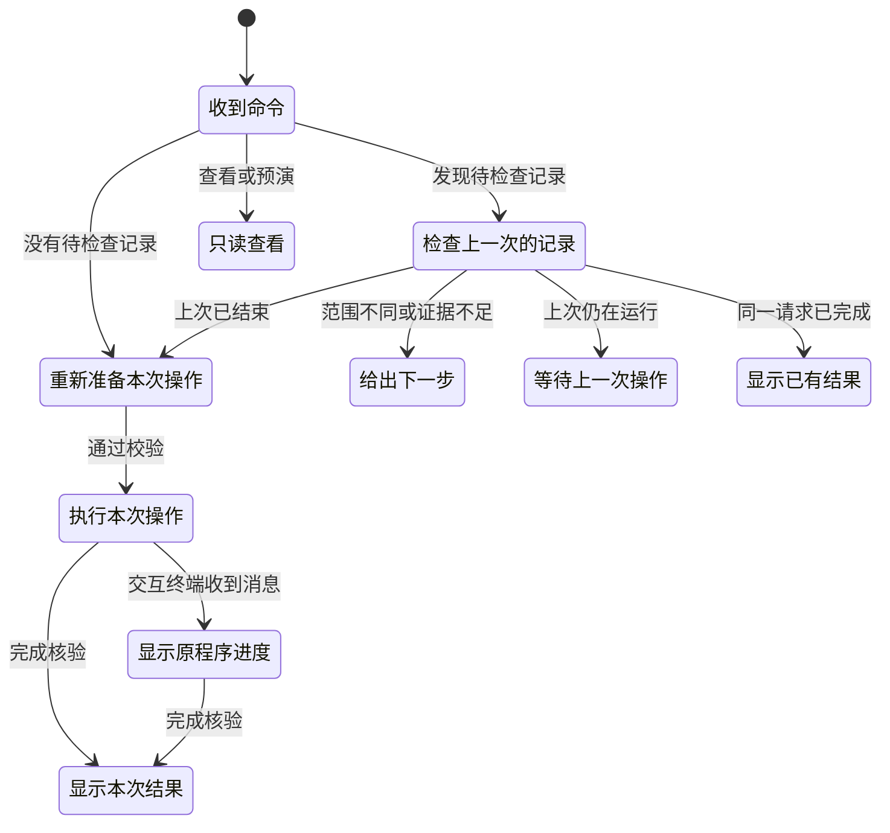
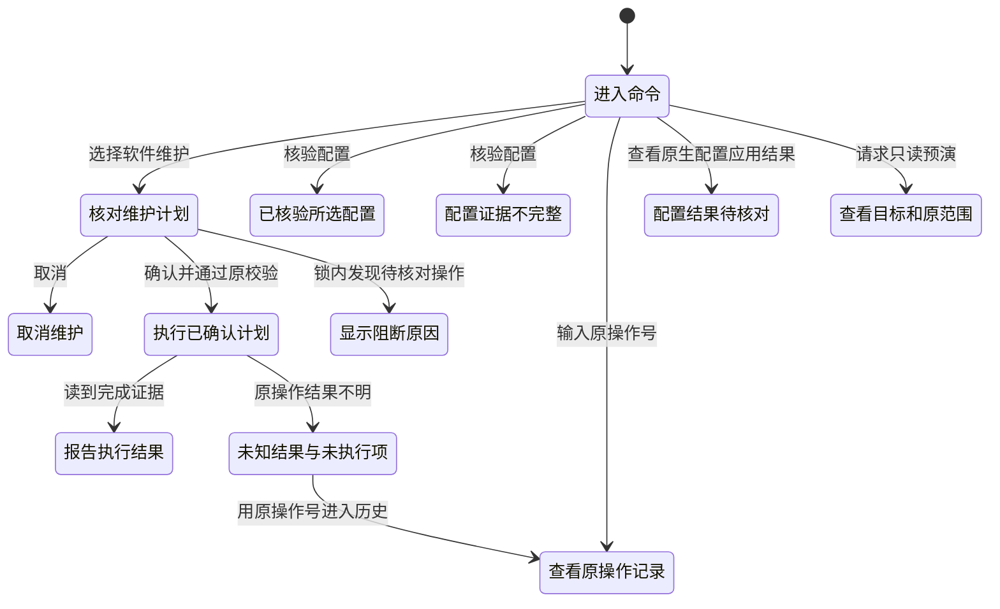

# 主要操作流程

推荐、安装与模型设置见 [推荐流程](recommend-flow.md)。本页覆盖从发现现有资源到日常维护和操作核对。

| 用户目标 | 操作流程 | 如何判断下一步 |
| --- | --- | --- |
| 找到对象并纳入管理 | 运行 `mo APP` 按名称搜索，或进入 `mo app` 浏览。搜索有多个结果时，按类型和 ID 选中目标。运行 `mo app adopt` 按安装范围选择，也可指定 `--id ID`。先预演，再确认。 | 对象详情显示安装范围、版本与登记配方。纳入管理记录已有安装和基线。后续写入资格取决于适配器、可用配方和来源证据。 |
| 安装、升级、卸载或控制服务 | 用 `mo app APP` 或 `mo app doctor APP` 核对当前状态。用 `mo app refresh` 刷新索引，`mo app outdated` 查可用版本。给维护命令加 `--dry-run` 查看目标与计划版本。用 `mo app service list` 查已声明的服务，再选择 `start` 或 `stop`。 | 单项预演显示版本和已核验的渠道。批量升级需要精确版本的条目单列，结果还没确认时会列出未执行项。 |
| 管理 chezmoi 配置 | 运行 `mo config enroll` 登记范围。用 `mo config list --refresh` 刷新受管路径，`mo config diff` 查看差异方向。打开 `mo config` 的对象详情可读实际文件和管理源。应用前运行 `mo config apply PATH --dry-run`，再按需应用并核验。 | 区分尚未登记、已登记待刷新、缓存证据和当前核验。预演只使用已有证据时显示目标尚待解析。需将现有普通文件纳入管理可用 `mo config adopt PATH`。停止管理用 `mo config forget ID`，保留实际文件。 |
| 管理技能、插件或策略 | 用 `mo skill` 查看部署和来源。用 `mo skill market` 找到市场入口，`mo skill plugins list` 检查本地插件绑定。固定技能配方后预演、确认或纳入管理。同步前运行 `mo skill sync --all --dry-run`。 | 分别检查安装、配置启用和会话载入。技能版本检查显示索引证据，批量维护明确列出未执行项。策略的核对入口见 `mo skill policy --help`。 |
| 查看 Agent 或切换单独配置 | 用 `mo agent` 查看档案，用 `mo agent tools` 核对 CLI 版本、本机固定版本和管理源固定版本。用 `mo agent launch PROFILE --dry-run` 确认档案、工作目录和插件偏好。 | 档案和工具版本分别显示。凭据状态用 `mo agent credential list` 查看。添加或激活凭据时，按界面提供的命令使用原生凭据工具。 |
| 核对历史，维护目录或搬迁状态 | 用 `mo history OP-ID` 查原操作。用 `mo recover ID --dry-run` 查看原计划摘要，再用 `mo recover ID` 核对结果。用 `mo dirs --roots` 核对目录，清理前先运行 `mo cleanup macops:cache --dry-run`。 | 清理预演区分可清理的自有文件与保留核对项。使用 `mo manifest plan FILE` 核对差异和可重放条件。搬迁旧状态前看 `mo migrate preflight` 的阻断项。沿用原环境和目录参数核对未决操作。 |

`mo help app`、`mo help config`、`mo help skill` 和 `mo help agent` 提供对应场景的入口示例。普通输出显示下一步需要的字段，完整的结构化证据可加 `--json` 查看。清单导出继续提供可供脚本处理的记录。全屏界面的执行状态独立显示，快捷键留在页脚。

配置刷新受原生过滤规则限制时，结果仍列出已观察路径，同时返回退出码 3 和 `incomplete: true`。批量升级中止后，结构化结果的 `unattempted` 列出后续未执行的目标。

[Agent CLI 升级与核对](agent-upgrade-flow.md) 说明已有操作、配置漂移和升级结果未知时的处理顺序。

## 命令没有完成时

| 看到的提示 | 现在怎么做 |
| --- | --- |
| 已取消 | 可以退出。想继续时，重新打开刚才的页面并查看计划。 |
| 上一次操作的结果还没确认 | 重跑原命令时，程序会先检查上一次的结果。同一次操作已经完成时，直接显示结果。 |
| 上一次操作还在运行 | 等它结束，再运行同一条命令。 |
| 操作跑过，但现在还不能确认结果 | 重试原命令，或运行 `mo recover` 查看待检查的操作。 |
| 清单只查到一部分 | 界面只列出已找到的项。先看提示中提到的位置或设置。 |

用 `--dry-run` 先看计划。用 `--timeout SECONDS` 设置每次运行外部程序最多等多少秒。升级时用 `--local` 只改本机安装和本机 mise 设置。核对后若决定保留当前安装和设置，可以用 `mo recover 操作号 --mark-failed` 把那次操作记为失败。命令会先提示确认。

`--mark-failed` 适用于支持手动记录失败、结果还没确定的操作。已有结果时，用普通 `mo recover` 查看结果或补齐记录。如果上一次操作是在为 npm 安装关联配方，也请用普通 `mo recover`。程序会根据找到的安装记录判断那次操作的结果。

会修改同一份管理记录的命令会先检查上一次的结果。查看清单、预演和独立的推荐模型设置可以照常使用。交互终端会实时显示原生安装和维护命令发出的消息。配置内容、验证查询和凭据保留在原有的处理流程中。`--json` 只输出结构化结果。

日常结果显示状态和下一步。需要操作号时，可在 `mo recover`、`mo history` 或 `--json` 的输出中查看。

## 自动核对状态



TLC 检查了 326 个状态，覆盖只读操作、恢复范围、重复执行、写入前的等待条件和 JSON 输出，共 5 条不变量及死锁检查。原生进程、文件权限和终端输出由隔离的 CLI 测试验证。模型与重跑入口见 [ResumeWrite](models/operation/ResumeWrite.tla) 和 [已有状态图验证命令](#状态检查)。

## 状态检查



模型在旧路径中找到五个反例。普通预演将关键信息埋在原始字段中，历史查询忽略操作编号，批量维护因未知结果中止时未列出后续未执行项，配置刷新把带过滤规则的证据标为完整，原生配置应用的未知结果缺少原操作的引用。新模型的 29 个状态通过了 6 条不变量和死锁检查。图省略等待期间的外部状态变化和终态停留。模型抽象了原生工具、文件系统和显示细节，实际命令行为在隔离环境中验收。

将 [MainJourneys 模型文件](models/control_plane/) 复制到独立临时目录。设置 `TLA2TOOLS` 指向 TLC JAR，`STATECHART` 指向 statechart 技能中的 `scripts/statechart`。在临时目录执行以下命令。将 CFG 中的 `Legacy` 改为 `TRUE` 可重放旧路径。

```sh
"$STATECHART" MainJourneys.tla --config MainJourneys.cfg \
  --view MainJourneys.view.mjs --out main-journeys
```
