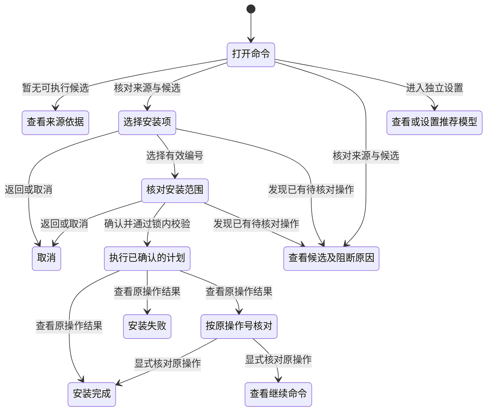
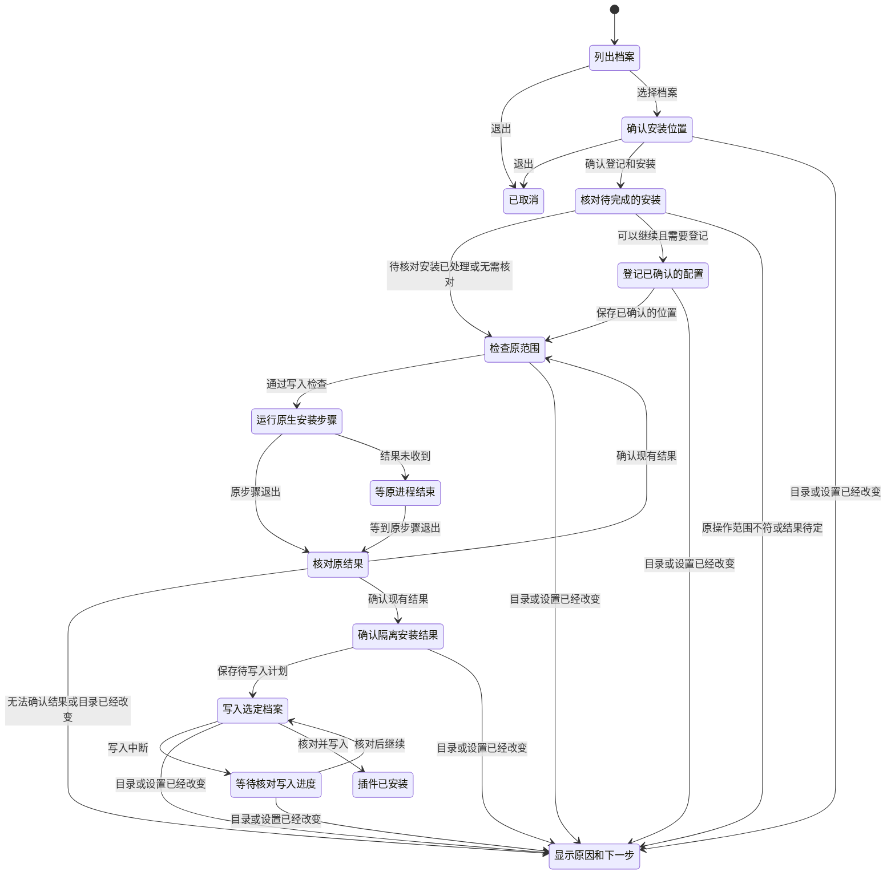

# 从推荐到核对安装结果

## 用户流程

| 需要完成的事 | 操作与结果 |
| --- | --- |
| 找到软件、技能或插件 | 运行 `mo recommend NAME`。可以直接输入 GitHub 仓库名 `OWNER/REPO`。适用时先选公开仓库，再查看固定提交和来源文档。刚开始可以直接使用本地分析。 |
| 选择模型或换钥 | 在终端运行 `mo recommend --setup`。查看当前模式，选择服务，输入不回显的密钥，确认连接测试，再确认保存。已有配置时可测试密钥或换模型。暂停后可用 `r` 重新启用。 |
| 选定安装位置 | 选中 Claude Code 或 Codex 插件后，按名称和配置目录选择已有档案。已纳入管理的档案排在前面。可输入多个编号，如 `3,5`，用逗号或空格分隔。「新建单独配置」需单独选择。直接按 Enter 返回。 |
| 登记已有档案 | 候选标为「可登记」时，核对名称和配置目录。登记位置与安装插件在同一次确认中说明。 |
| 确认安装 | 核对插件名称、版本、安装位置和来源。输入 `yes` 安装并启用，输入 `disabled` 安装后保持停用。选了尚未登记的配置时，这一次确认也会登记位置。直接按 Enter 取消。 |
| 查看结果 | 安装到已有档案后，用原来的 Agent 命令启动。多选安装遇到失败或需要核对的结果会停下，并列出尚未尝试的档案。新建单独配置可在 `mo agent` 中查看、启动或按 `x` 卸载。命令行用 `mo agent uninstall PROFILE --dry-run` 预览位置。卸载将整个配置移到同一状态目录下的归档位置。结果还没确认时，可以在原档案重试，或运行 `mo recover` 查看记录。 |
| 处理已有阻断 | 安装到已有配置时，确认后自动核对选定配置的未完成安装。已有操作涉及其他位置时，终端会说明原因和下一步。 |
| 核对与继续 | `mo recover` 查看待核对操作及名称。Codex 或 Claude Code 的后续阶段满足继续条件时，`mo recover ID` 显示 `mo agent resume ID`。可先加 `--dry-run` 查看下一步，随后沿用原作用域确认继续。 |

日常推荐读取钥匙串失败时会继续本地分析。需要 macOS 授权时，在 `mo recommend --setup` 中选 `t`，按系统提示访问已保存的密钥。模型设置中断后，通过 `mo recommend --setup` 的 `c` 核对原凭据操作。模型设置与软件操作分别使用各自的锁和记录。

安装到已有档案时，`mo` 先在隔离目录核验固定来源和载荷，再向选定档案写入该插件所需的文件和登记项。遇到同名来源、文件链接或写入期间的改动时会停下来，保留现有文件以便核对。

## 交互与事务边界

候选展示、选择和确认由推荐界面处理。安装到一个或多个已有配置时，确认后先复查所选目录，再核对与所选位置匹配的未完成安装。之后按选择顺序登记、核验和安装。适配器持锁复查目录及来源。已写入的安装结果经复查可以直接返回，已经核验的原生步骤可以沿用。

`--json` 保留原有结构化数据。需要查看完整记录时，使用 `mo recover ID --dry-run --json`。终端的核对清单显示名称、状态和操作号。证据不完整时提示清单可能不全。成功阶段的结果与后续步骤分别显示。

## 状态图



旧流程模型在 51 个状态中复现四条路径。单个 Codex 候选直接进入确认，已有未决操作时跳过展示，输错编号等同取消，Claude 核对完成后普通文本没有展示继续命令。新流程模型有 56 个状态，6 条不变量及死锁检查通过。图省略在同一页面重输、外部状态变化及终态停留。模型验证交互中可见的状态与命令交接，持久化和原生命令的细节由适配器回归测试覆盖。

将三个 [RecommendJourney 模型文件](models/control_plane/) 复制到独立临时目录。将 `TLA2TOOLS` 设为 TLC JAR 的绝对路径，`STATECHART` 设为 statechart 技能目录下 `scripts/statechart` 的绝对路径。在临时目录执行以下命令。将 CFG 中的 `Legacy` 改为 `TRUE` 可重放旧流程反例。

```sh
"$STATECHART" RecommendJourney.tla --config RecommendJourney.cfg \
  --view RecommendJourney.view.mjs --out recommend-journey
```

## 安装位置状态图



TLC 检查了 434 个不同状态、10 条不变量和死锁。模型覆盖单个目标的确认、原操作核对和隔离安装。图省略检查期间的外部变化和终态停留。多选调用同一流程，每个配置的成功以核验后的写入结果为准。批量遇到异常就停在当前配置，终端列出尚未开始本次安装的配置。回归测试覆盖批量顺序、中途停止及核对批次中后续配置的旧操作。复制 [AgentInstallTarget 模型文件](models/agent_install/) 到独立目录，沿用上面的工具设置运行 `"$STATECHART" AgentInstallTarget.tla --config AgentInstallTarget.cfg --view AgentInstallTarget.view.mjs --out agent-install-target`。

交互安装默认显示 mo 的核验、隔离安装、写入和结果。加 `--verbose` 查看原生工具的诊断。Codex 的原生 JSON 中是暂存路径，安装结果中的目标是最终配置目录。输出按 GitHub CLI 的[终端与结构化输出](https://cli.github.com/manual/gh_help_formatting)和 Homebrew 的[详细输出选项](https://docs.brew.sh/Manpage.html)分层设计。
